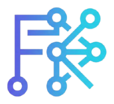

<div align="center">
  
  <h1>Farhan Maulana Syidiq</h1>
  <p><strong>Portfolio &amp; Personal Platform</strong></p>
  <p>
    Network operations, infrastructure, and web development — presented in one place.
  </p>
  <p>
    
    
    
    
  </p>
</div>

---

## Deskripsi

Website portofolio profesional **Farhan Maulana Syidiq** — NOC Engineer, Network Administrator, dan Web Developer. Situs ini menampilkan profil, keahlian, pengalaman, sertifikasi, pendidikan, proyek beserta studi kasusnya, testimoni, dan artikel blog dalam antarmuka yang responsif.

Dilengkapi panel admin khusus untuk mengelola konten dan pesan tanpa CMS eksternal. Dibangun dengan Laravel 12, Blade, Tailwind CSS 4, dan Alpine.js, dengan fokus pada pengalaman yang ringan, mudah dirawat, serta aman dikonfigurasi untuk deployment sendiri.

## Fitur

- **Portofolio publik:** profil, keahlian, pengalaman, pendidikan, sertifikasi, proyek, studi kasus, dan testimoni.
- **Blog:** artikel, pencarian, kategori, dan umpan RSS.
- **CV dan kontak:** halaman CV siap cetak serta formulir kontak dengan validasi, honeypot, dan pembatasan permintaan.
- **Panel admin:** dashboard, analitik halaman, dan pengelolaan proyek, artikel, testimoni, pengalaman, sertifikasi, pendidikan, profil, kontak, tautan aplikasi, dan pesan.
- **SEO:** sitemap, robots.txt, canonical URL, Open Graph, Twitter Card, dan metadata proyek.
- **Privasi:** analitik menyimpan jumlah permintaan per hari dan path saja; alamat IP maupun identitas pengunjung tidak disimpan.

## Teknologi

| Bagian | Teknologi |
|---|---|
| Backend | PHP 8.2+, Laravel 12 |
| Antarmuka | Blade, Tailwind CSS 4, Alpine.js |
| Database | MySQL atau MariaDB |
| Build aset | Vite, npm |
| Deployment | Nginx, PHP-FPM, Ubuntu/Debian |

## Memulai

### Prasyarat

- PHP 8.2 atau lebih baru beserta ekstensi Laravel yang diperlukan
- Composer
- Node.js dan npm
- MySQL/MariaDB

### Instalasi lokal

1. Clone repository dan masuk ke folder project:

   ```bash
   git clone https://github.com/aleaengineer/MY-WEBSITE.git
   cd MY-WEBSITE
   ```

2. Install dependency dan siapkan konfigurasi:

   ```bash
   composer install
   npm install
   copy .env.example .env
   php artisan key:generate
   ```

   Di macOS/Linux, gunakan `cp .env.example .env` sebagai pengganti `copy`.

3. Atur koneksi database serta kredensial admin unik di `.env`:

   ```dotenv
   DB_DATABASE=portfolio
   DB_USERNAME=root
   DB_PASSWORD=
   ADMIN_EMAIL=admin@example.com
   ADMIN_PASSWORD=ganti-dengan-password-unik-minimal-8-karakter
   ```

   Jangan gunakan contoh nilai di atas sebagai kredensial produksi. Seeder admin memerlukan `ADMIN_PASSWORD` yang Anda tentukan sendiri.

4. Jalankan migrasi, buat tautan storage, build aset, dan mulai server:

   ```bash
   php artisan migrate --seed
   php artisan storage:link
   npm run build
   php artisan serve
   ```

   Buka `http://127.0.0.1:8000`. Untuk panduan XAMPP/Laragon yang lebih rinci, lihat [LOCAL_SETUP.md](LOCAL_SETUP.md).

### Pengembangan frontend

Jalankan server Laravel dan Vite secara terpisah:

```bash
php artisan serve
npm run dev
```

## Pengujian

```bash
php artisan test
```

## Dokumentasi

| Dokumen | Keterangan |
|---|---|
| [LOCAL_SETUP.md](LOCAL_SETUP.md) | Setup lokal dengan XAMPP atau Laragon |
| [DEPLOYMENT.md](DEPLOYMENT.md) | Deployment VPS Ubuntu/Debian dan SSL Let's Encrypt |
| [Konfigurasi Nginx](deploy/nginx/portfolio.conf) | Contoh virtual host untuk produksi |

## Struktur Project

```text
app/
├── Http/
│   ├── Controllers/       # Halaman publik, autentikasi, dan panel admin
│   └── Middleware/        # Pelacakan analitik halaman
├── Models/                # Model portofolio dan konten
database/
├── migrations/            # Skema database
└── seeders/               # Data awal dan akun admin terkonfigurasi
resources/
├── css/                   # Tailwind CSS dan gaya situs
├── js/                    # Interaksi antarmuka
└── views/                 # Halaman Blade publik dan admin
routes/
└── web.php                # Rute aplikasi
```

## Lisensi

Project ini menggunakan [MIT License](LICENSE).

<div align="center">
  <sub>Dibuat dengan Laravel untuk menampilkan karya, pengalaman, dan perjalanan profesional.</sub>
</div>
